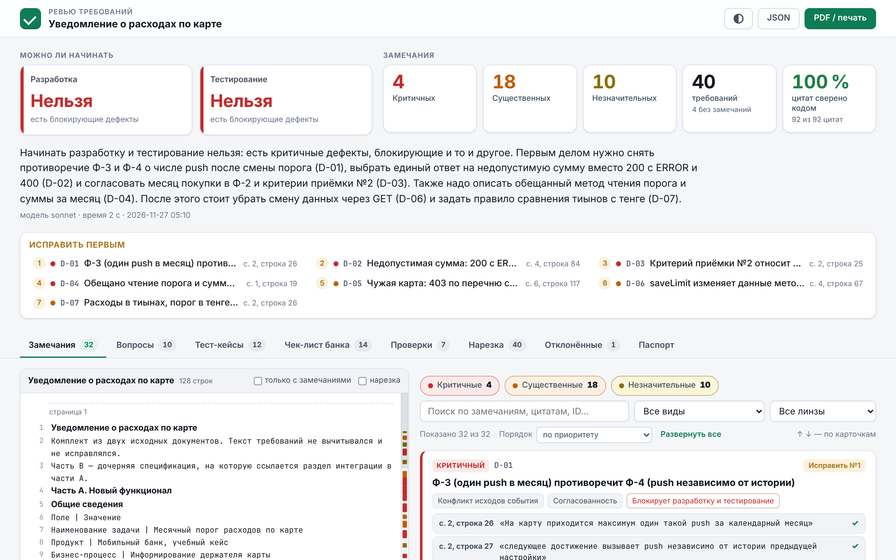

# BCC Review — ИИ-агент проверки требований

Агент читает документ требований (PDF, DOCX, Markdown, HTML, TXT) и до начала разработки пишет отчёт на русском:
какие в документе требования, что с каждым не так, где документ противоречит сам себе, чего не хватает и можно ли
начинать разработку и тестирование. Решение кейса BCC-HUB × MNU FinTech Hackathon «ИИ-агент проверки требований»
([ТЗ](https://github.com/BCC-HUB/ai-requirements-validator-task)).

**Видео-демо:** [`presentation/demo.mp4`](presentation/demo.mp4) · **Слайды:** [`presentation/deck.pdf`](presentation/deck.pdf) ·
**Готовый отчёт по документу кейса:** [`reports/requirements.md`](reports/requirements.md)
(интерактивный — [`reports/requirements.html`](reports/requirements.html)) · **Что сдаём:** [`SUBMISSION.md`](SUBMISSION.md)

* **Каждое замечание доказано.** Дословная цитата и номер строки (для PDF — и страница); цитату ищет в исходнике
  программа, а не модель. Замечание без найденной цитаты в отчёт не попадает, `verify` перепроверяет отчёт заново.
* **Без общих фраз.** Критерий стандарта (ISO/IEC/IEEE 29148, IEEE 830), сценарий, последствия и готовая
  формулировка «было → стало».
* **Вердикт считает код** по записанному правилу; модель только ищет и обосновывает дефекты.
* **Ведёт к готовому ТЗ:** вопросы владельцу с вариантами ответа, пересмотр после ответов, исправленная редакция.
* **Работает на бесплатном Gemini,** на подписке Claude и в закрытом контуре банка (Ollama, vLLM).

---

## Быстрый старт

Нужны [Python 3.11, 3.12 или 3.13](https://www.python.org/downloads/) и [Git](https://git-scm.com/downloads).

### Шаг 1. Скачать и установить

**Windows (PowerShell):**

```powershell
git clone https://github.com/diiaanns07-droid/winnersOFbankCCbyMNU.git
cd winnersOFbankCCbyMNU
py -3.12 -m venv .venv
Set-ExecutionPolicy -Scope Process -ExecutionPolicy Bypass -Force
.\.venv\Scripts\Activate.ps1
python -m pip install -r requirements.txt -e .
```

**macOS и Linux:**

```bash
git clone https://github.com/diiaanns07-droid/winnersOFbankCCbyMNU.git
cd winnersOFbankCCbyMNU
python3.12 -m venv .venv
source .venv/bin/activate
python -m pip install -r requirements.txt -e .
```

Другая версия Python — укажите её (`py -3.13`, `python3.11`). Нет команды `py` — пишите `python`. На Ubuntu для
venv нужен пакет `python3.12-venv`. Дальше все команды — в активированном окружении (в начале строки `(.venv)`).

### Шаг 2. Ключ Gemini (бесплатно, без карты)

1. Откройте [Google AI Studio → API keys](https://aistudio.google.com/apikey), войдите аккаунтом Google,
   нажмите **Create API key** и скопируйте ключ (строка `AIza…`).
2. Создайте `.env` из шаблона `.env.example` и впишите ключ после `GEMINI_API_KEY=` (без кавычек и пробелов):

```powershell
Copy-Item .env.example .env
notepad .env
```

```bash
cp .env.example .env
nano .env
```

`.env` лежит в корне репозитория и в git не попадает. Можно и без файла: `$env:GEMINI_API_KEY = "ключ"`
(PowerShell) или `export GEMINI_API_KEY=ключ` (bash).

### Шаг 3. Запуск — одна команда

```bash
python -m bcc_review release/input/requirements.md reports/my/requirements.md
```

Формат: `python -m bcc_review <файл требований> <файл отчёта.md>`. Вход — `.pdf`, `.docx`, `.md`, `.html` или
`.txt`; каталог отчёта создаётся сам, на Windows пути можно писать через `\`. Модель — `gemini-3.8-flash`; если она
перегружена или недоступна, агент сам переходит на `gemini-3.6-flash`, затем на `gemini-3.5-flash-lite`.
Прогон занимает несколько минут; в конце в терминале — вердикт, блокеры и пути к файлам отчёта.

Проверить ключ заранее (10 секунд): `python -m bcc_review doctor --live`.

**Всё сразу одним скриптом** — сам создаст `.venv`, поставит зависимости, создаст `.env`, проверит документ и
запустит `verify` (без аргумента — документ кейса, с аргументом — ваш файл):

```powershell
powershell -ExecutionPolicy Bypass -File scripts\run_official.ps1
```

```bash
scripts/run_official.sh
```

**Без ключа:** `--provider mock` — весь конвейер за секунду на записанных ответах живого прогона модели по документу
кейса (настоящий отчёт; на других документах ответы пустые); `--provider offline` — только детерминированные
правила, без модели, отчёт честно помечен как предварительный.

## Куда ложится отчёт

Для `python -m bcc_review ТЗ.pdf out/report.md`:

| Файл | Что это |
| :--- | :--- |
| `out/report.md` | отчёт для чтения (GitHub, VS Code, любой просмотрщик Markdown) |
| `out/report.json` | то же для программ: замечания, полные цитаты, паспорт прогона (схема `contracts/v2.json`) |
| `out/report.html` | интерактивный отчёт одним файлом: документ с подсвеченными цитатами, фильтры, работает без интернета |
| `out/report.annotated.docx` / `.annotated.pdf` | по `--export docx` / `--export pdf`: копия документа с комментариями на местах цитат |
| `out/report.jira.csv` | по `--export jira`: замечание — строка для импорта в Jira |
| `out/report.revised.md` | по `--revise`: исправленная редакция ТЗ |
| `runs/<id прогона>/` | журнал: вход и выход каждого этапа, каждое обращение к модели |

Проверить отчёт независимо от агента — каждая цитата ищется в исходнике заново, сверяются SHA-256 и счётчики:

```bash
python -m bcc_review verify reports/my/requirements.json release/input/requirements.md
```

## Пример первого экрана



В терминале после прогона (здесь `--provider mock`: записанные ответы живого прогона Sonnet по документу кейса):

```text
BCC Review: «Уведомление о расходах по карте» — 40 требований, 32 дефекта (критичных 4, существенных 14, незначительных 14), вопросов 10
Разработка: нельзя · тестирование: нельзя
  D-01 Ф-3 (один push в месяц) противоречит Ф-4 (push независимо от истории) — блокирует разработку и тестирование
  D-02 Критерий приёмки №2 относит покупку к февралю, а Ф-2 — к месяцу покупки — блокирует разработку и тестирование
  D-03 Недопустимая сумма: ответ 200 с ERROR или 400, а 200 считается успехом — блокирует разработку и тестирование
Прогон завершён полностью: 0 с, 9 вызовов модели, mock; цитат сверено 87 из 87
Отчёт: reports/my/requirements.md и reports/my/requirements.json
HTML: reports/my/requirements.html
```

## Что в отчёте

Разделы — в порядке п. 6 ТЗ:

* **Кратко** (первый экран): можно ли начинать разработку и тестирование, блокеры, «что исправить первым».
* **1. Паспорт прогона:** документ и его SHA-256, дата, фактическая модель, провайдер, коммит агента, вызовы, время.
* **2. Нарезка:** «ID в отчёте — ID в документе — вид — формулировка — место»; что не вошло и почему.
* **3. Каждое требование:** матрица «требование × нарушенные критерии»; карточки замечаний — критерий стандарта,
  цитаты с местом, проблема, сценарий, последствия, «было → стало», вопрос владельцу.
* **4. Набор целиком:** противоречия на конкретном сценарии, исполнение критериев приёмки, полнота, прослеживаемость,
  глоссарий разночтений.
* **5. Сводка** и **6. Итог:** числа по видам дефектов; вердикт с обоснованием и порядком исправлений.
* **Приложения:** вопросы владельцу, черновик тест-кейсов, заполненный чек-лист «Ревью требований» банка, все
  «было → стало», как работал агент (отклонённые кандидаты с причинами), методика.

## Как мы проверяем качество

Эталон официального документа — 5 критичных дефектов К1–К5 и 20 существенных С1–С20
([`docs/task-analysis.md`](docs/task-analysis.md), раздел 5); счёт строгий и детерминированный
(`python -m evaluation.v2.score отчёт.json`). Корпус [`evaluation/dev`](evaluation/dev) — 4 банковские темы,
24 документа с заложенными дефектами и 8 чистых, на которых агент не должен поднимать тревогу.

<!-- числа №15: источник — evaluation/v2/RESULTS.md и docs/plan-v2/INTEGRATION.md -->
| Метрика | Цель | Sonnet, 27.11 04:14 | Haiku, 27.11 03:08 | v1 (правила) |
| :--- | :--- | :--- | :--- | :--- |
| К1–К5 найдены | 5 из 5 (на Gemini Flash ≥ 4) | **5 из 5** (критичными 4) | 3 из 5 | 3 из 5 |
| С1–С20 найдены | ≥ 16 из 20 | **18 из 20** | — | 7 из 20 |
| Ложных критичных | 0 | **0** | — | 0 |
| Замечаний (крит./сущ./незн.) | 25–45 | 32 (4/14/14) | 15 (3/6/6) | 27 (2/11/14) |
| Цитаты сверены программой | 100 % | **100 %** (87 из 87) | — | 100 % (66 из 66) |
| Статус, время, обращений к модели | полный, ≤ 6 мин, ≤ 12 | полный, 4 мин 11 с, 9 | частичный, 13 мин 55 с, 9 | — |

Корпус, только правила (без модели): точность 0,80, полнота 0,43, **0 ложных тревог на 8 чистых документах**
(у v1 — тревоги на всех 8). Замеры с моделью на корпусе, стабильность и сравнение моделей —
[`evaluation/v2/RESULTS.md`](evaluation/v2/RESULTS.md).

## Модели и провайдеры

| `--provider` | Что нужно | Модель по умолчанию |
| :--- | :--- | :--- |
| `gemini` | `GEMINI_API_KEY` ([бесплатно](https://aistudio.google.com/apikey)) | `gemini-3.8-flash` → `gemini-3.6-flash` → `gemini-3.5-flash-lite` |
| `claude_cli` | установленный и авторизованный [Claude Code](https://docs.claude.com/en/docs/claude-code), ключ не нужен | `opus` (`CLAUDE_CLI_MODEL`) |
| `anthropic` | `ANTHROPIC_API_KEY` | `claude-opus-5-5` (`ANTHROPIC_MODEL`) |
| `openai` | `OPENAI_BASE_URL`, `OPENAI_MODEL` | закрытый контур: Ollama, vLLM, LM Studio; также OpenRouter |
| `offline` | ничего | без модели, только правила |
| `mock` | ничего | записанные ответы живого прогона (демонстрация и тесты) |

`auto` (по умолчанию) выбирает первое доступное: `GEMINI_API_KEY` → `ANTHROPIC_API_KEY` → `OPENAI_BASE_URL` →
установлен `claude` → `offline`. Фактическая модель всегда записывается в паспорт. Все переменные — в
[`.env.example`](.env.example); настройку показывает `python -m bcc_review doctor`.

**Закрытый контур банка** — документ не покидает периметр:

```bash
ollama pull qwen3:32b
# в .env: OPENAI_BASE_URL=http://localhost:11434/v1 и OPENAI_MODEL=qwen3:32b
python -m bcc_review ТЗ.pdf out/report.md --provider openai
```

## Параметры командной строки

```text
python -m bcc_review ВХОД ОТЧЁТ.md [параметры]
python -m bcc_review verify ОТЧЁТ.json ВХОД
python -m bcc_review doctor [--live] [--provider ИМЯ] [--model ИМЯ]
python -m bcc_review stage ЭТАП --doc ВХОД --from runs/<id прогона>
```

| Параметр | Что делает |
| :--- | :--- |
| `--provider ИМЯ`, `--model ИМЯ` | провайдер и модель (см. таблицу выше) |
| `--fallback-models СПИСОК` | запасные модели через запятую |
| `--export СПИСОК` | дополнительно `jira`, `docx`, `pdf` через запятую (HTML пишется всегда; `--no-html` — не писать) |
| `--answers ФАЙЛ`, `--revise` | ответы на вопросы отчёта и исправленная редакция ТЗ (см. ниже) |
| `--passes N` | запустить ревьюеров N раз (устойчивее находки, больше вызовов) |
| `--lenses СПИСОК` | какие ревьюеры работают: `analyst,qa,architect,risk` |
| `--no-consistency`, `--no-clarify` | без проверки набора целиком / без вопросов владельцу |
| `--max-calls N`, `--max-seconds N`, `--timeout N` | бюджет обращений к модели (16), времени прогона и одного обращения, с |
| `--no-cache`, `--cache-dir КАТАЛОГ` | не брать ответы модели из кэша `.bcc_cache/` / другой каталог кэша |
| `--runs-dir КАТАЛОГ`, `--run-id ИМЯ` | где хранить журнал прогона (`runs/`) и как назвать его каталог |
| `--fail-on blocker\|partial` | ненулевой код выхода при блокере или неполном прогоне (для CI) |
| `-q`, `--quiet` | без хода выполнения в консоли |

Коды выхода: `0` — отчёт записан; `2` — входной файл не найден (с `--fail-on blocker` — и вердикт «нельзя»);
`3` — модель недоступна (нет ключа, квота) или прогон сорвался — отчёт всё равно записан, собран правилами;
`4` — `verify` нашёл расхождение с документом или паспортом.

## Режим ответов и исправленное ТЗ

В приложении отчёта — вопросы владельцу документа с 2–4 вариантами ответа. Ответы — файл по строке на вопрос
(в HTML-отчёте их можно отметить на вкладке «Вопросы» и нажать «Скачать ответы»):

```text
Q-01: B
Q-02 [лимит уведомлений в месяц]: не более одного уведомления за календарный месяц
```

```bash
python -m bcc_review release/input/requirements.md reports/demo.md --answers examples/v2/answers.md --revise
```

Агент пересматривает затронутые замечания (снято, осталось, изменилось), проверяет, не появилось ли новых
противоречий, показывает таблицу «до / после уточнения», а с `--revise` пишет исправленную редакцию ТЗ;
где ответа нет — маркер `<уточнить: …>`. Пример ответов — [`examples/v2/answers.md`](examples/v2/answers.md).

**Веб-демо:** `python -m bcc_review.v2.web --open` → <http://127.0.0.1:8014/> — перетащите файл, выберите провайдера,
смотрите этапы, отчёт с подсветкой цитат и выгрузки (HTML, Markdown, JSON, Word, PDF, Jira CSV).

## Как устроен агент

```text
файл ─► документ с номерами строк и страниц                                 (код)
     ─► правила: размытые слова, заглушки, единицы, контракт API            (код)
     ─► нарезка на требования R-01…, что исключено и почему                  (модель ×1)
     ─► параллельно четыре ревьюера и проверка набора:                       (модель ×5)
          аналитик · тестировщик · архитектор · риски/ИБ · противоречия набора
     ─► сверка цитат: каждая ищется в документе, строку считает код         (код)
     ─► судья: дубли, отсев ложных с причиной, серьёзность, чек-лист банка   (модель ×1–2)
     ─► вопросы владельцу с вариантами ответа                                (модель ×1)
     ─► вердикт по правилу ─► отчёт MD, JSON, HTML (+ DOCX, PDF, Jira)       (код)
```

Обычно 9–10 обращений к модели. Ответ модели проверяется по JSON-схеме; обрезанный запрашивается с бо́льшим лимитом
или частями; 429 и 5xx повторяются с паузой, затем подключается запасная модель. Если этап не удался, отчёт
помечен «частичный», и вердикт не выше «условно».

**Вердикт.** Критичный — два места документа дают несовместимый результат для одного входа, ключевое правило нельзя
однозначно реализовать или проверить, нет информации для основной функции. Есть критичный, блокирующий
разработку, → разработку **нельзя**; блокирующий тестирование → тестирование **нельзя**; иначе три и больше
существенных → **условно**; иначе **можно**.

## Docker

```bash
docker build -t bcc-review .
docker run --rm --env-file .env -v "$(pwd)/reports:/app/reports" bcc-review release/input/requirements.md reports/docker/requirements.md
```

В PowerShell вместо `$(pwd)` — `${PWD}`. Свой документ положите в `reports/` и передайте `reports/<файл>`.
В контейнере работают `gemini`, `anthropic`, `openai`, `offline` и `mock`; `claude_cli` — нет.

## Ограничения

* Ревью статическое: агент читает текст и не запускает описанную систему.
* Модель может ошибаться. Цитаты и строки проверяет программа, но правоту замечания по существу решает человек;
  отклонённые кандидаты с причинами видны в приложении отчёта.
* Слабая модель находит меньше: на Haiku прогон был частичным (3 из 5 критичных). Для лучшего качества —
  `claude_cli` или `anthropic`; на бесплатном Gemini Flash цель — не меньше 4 из 5.
* Сканированный PDF без текстового слоя не читается (нет OCR).
* Бесплатный Gemini ограничивает запросы в минуту и в сутки: при 429 агент ждёт и повторяет; если суточная квота
  исчерпана, отчёт будет частичным — повторите позже, готовые ответы возьмутся из кэша.
* Отчёт — на русском; документы на казахском и английском читаются.
* С облачными провайдерами текст документа уходит во внешний API; для закрытых документов — `openai` с локальной
  моделью.

## Частые проблемы

| Симптом | Что сделать |
| :--- | :--- |
| `No module named bcc_review` | окружение не активировано или не выполнен шаг 1 |
| «запуск сценариев отключён» при `Activate.ps1` | `Set-ExecutionPolicy -Scope Process -ExecutionPolicy Bypass -Force` в том же окне |
| код 3, «Не задан GEMINI_API_KEY» или «модель недоступна» | проверьте строку `GEMINI_API_KEY=` в `.env`, запускайте из корня репозитория, затем `python -m bcc_review doctor --live` |
| 429, квота | подождите минуту и повторите — готовые ответы возьмутся из кэша |
| статус «частичный» | в паспорте названы этапы, которые не удались; повторите прогон |

Проверка «как у жюри» одной командой — ключ, прогон без кэша, `verify`, сверка с эталоном и сводка:
`powershell -ExecutionPolicy Bypass -File scripts\jury_check.ps1` или `scripts/jury_check.sh`.

## Структура репозитория

| Путь | Что там |
| :--- | :--- |
| `src/bcc_review/v2/` | ядро агента: этапы, промпты, провайдеры, сверка цитат, отчёты |
| `release/input/` | официальный документ кейса (`requirements.md`) и его PDF |
| `reports/` | финальные отчёты агента и таблица прогонов |
| `evaluation/` | эталон, корпус и счётчик качества |
| `scripts/` | одна команда для запуска и проверки, финальные отчёты |
| `presentation/` | слайды, видео-демо, скриншоты |
| `tests/v2/` | тесты без сети: `python -m pytest tests/v2 -q` |
| `docs/` | разбор задачи, план и контракт v2 |
