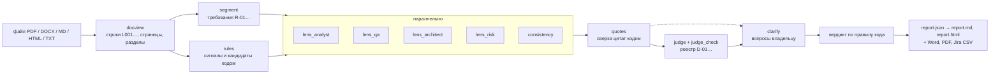

# Архитектура агента проверки требований (ядро v2)

Техническое описание для жюри: из чего состоит агент, какие данные ходят между этапами, почему каждому замечанию
можно верить и что происходит, когда модель или документ ведут себя плохо. Код — `src/bcc_review/v2/`, контракт
данных — `docs/plan-v2/CONTRACT.md` и схема отчёта `contracts/v2.json`.

```bash
python -m bcc_review release/input/requirements.pdf out/report.md          # → report.md, report.json, report.html
python -m bcc_review verify out/report.json release/input/requirements.pdf  # перепроверка отчёта без модели
python -m bcc_review doctor --live                                          # какая модель доступна и почему
```

## 1. Главная идея

**Модель предлагает — код проверяет.** Модель хорошо видит смысл (противоречие, неполноту, неоднозначность), но
может ошибиться в цитате, строке, серьёзности и итоговом решении. Поэтому всё, что можно проверить без модели,
делает код:

| Делает модель | Делает код |
| :--- | :--- |
| нарезает документ на требования | номера строк, страницы и разделы; ID `R-01…`; покрытие каждой строки |
| ищет дефекты с четырёх ролей и в наборе целиком | сверяет каждую цитату с документом; без цитаты замечания нет |
| объединяет дубли, отсеивает ложные, пишет тексты | калибрует серьёзность по шкале; приоритеты; ссылки на пункты стандартов |
| пишет обоснование вердикта и вопросы владельцу | **сам вердикт** — по правилу; варианты ответов и ссылки вопросов проверяет |

## 2. Схема конвейера



Без Mermaid то же самое: `docview → rules → segment → [4 линзы ‖ набор] → сверка цитат → судья → вопросы →
вердикт кодом → отчёт`. Обычный прогон — **9 вызовов модели**: нарезка 1, линзы 4, набор 1, судья 1, вторая
проверка серьёзности 1, вопросы 1. Пять проверяющих этапов идут параллельно; вопросы владельцу стартуют сразу после
сверки цитат — параллельно с судьёй, по кандидатам (пунктир на схеме), а после судьи код привязывает их к итоговым
дефектам (не легли на критичные — один повторный вызов по итоговым). Поэтому время прогона ≈ нарезка + самая долгая
линза + судья. Опция `--fast-start` убирает и ожидание нарезки: рецензенты стартуют по таблице требований эвристики
кода, нарезка моделью идёт параллельно, а ссылки `R-NN` потом переводятся кодом по пересечению строк.

## 3. Этапы и зачем каждый

| Этап | Кто | Вызовов | Зачем | Выход |
| :--- | :--- | ---: | :--- | :--- |
| `docview` (№03) | код | 0 | Единая нумерация строк для любого формата: всё, что дальше говорит «строка 38», говорит про одну и ту же строку. Таблицы — ячейки через « \| », у PDF — номер страницы. | `DocView` |
| `rules` (№12) | код | 0 | Высокоточные сигналы без модели: заглушки и пустой шаблон, обещанная, но не описанная операция API, единицы измерения, размытые слова (29148 п. 5.2.7), вставки для модели («игнорируй…»). Сигналы — подсказки линзам, кандидаты — судье. Они же — весь отчёт в режиме без модели. | `signals`, `candidates` |
| `segment` (№04) | модель + код | 1 (длинный документ — по части на ~250 строк) | Атомарные требования с ID документа (`Ф-2`) и диапазоном строк. Код проверяет, что каждая непустая строка — в требовании, в исключённом фрагменте (шаблон, согласующие, примеры) или заголовок; непокрытое — короткий дозапрос, затем код сам. | `requirements`, `excluded` |
| `lens_analyst` (№05) | модель + код | 1 | Однозначность, полнота, единичность, термины — каждое требование отдельно (29148 п. 5.2.5). | кандидаты |
| `lens_qa` (№06) | модель + код | 1 | Исполняет каждую строку критериев приёмки по правилам документа: «ожидаем по правилам» ↔ «заявлено»; несовпадение — критичное противоречие с цитатами обеих сторон. Плюс проверяемость и тест-кейсы. | кандидаты, `acceptance_checks`, `test_cases` |
| `lens_architect` (№07) | модель + код | 1 | Контракт API (методы, коды, типы полей), стык со спецификацией, данные и события. | кандидаты |
| `lens_risk` (№08) | модель + код | 1 | Банковский домен, ИБ и эксплуатация — только с текстовой зацепкой в документе: замечание о теме, которой документ не касается, код снимает. | кандидаты, `dropped` |
| `consistency` (№09) | модель + код | 1 | Набор целиком (29148 п. 5.2.6): попарная сверка требований **по одному предмету** на конкретном сценарии, трассировка «требование → приёмка», глоссарий. | кандидаты, `pair_checks`, `trace`, `glossary` |
| `quotes` (№03) | код | 0 | Сверка каждой цитаты каждого кандидата с документом (раздел 5). Не нашлась ни одна — кандидат в `rejected` с причиной «цитата не найдена». | сверенные кандидаты |
| `judge` (№10) | модель + код | 1 + 1 | Одна проблема — одно замечание: дубли от разных ролей сливаются, ложные отклоняются с причиной; серьёзность, приоритет 1…7, тексты для аналитика, чек-лист банка, обоснование вердикта. Вторая проверка серьёзности (`judge_check`) — отдельным коротким вызовом. Цитаты судья не пишет: доказательства дефекта код собирает из кандидатов. | `findings`, `rejected`, `checklist` |
| `clarify` (№11) | модель + код | 1 (параллельно с судьёй) | Вопросы владельцу продукта там, где нужен выбор бизнеса: 2–4 различных варианта, ссылки на дефекты, блокирующие — первыми, не больше 10. | `questions` |
| вердикт | код | 0 | Раздел 6. | `verdict` |
| отчёт (№13) | код | 0 | `report.json` по схеме, затем Markdown и HTML из него; экспорт Word с комментариями, PDF с выделениями, Jira CSV. | файлы |

Режимы после основного прогона: `--answers ответы.md` — пересмотр дефектов по ответам владельца и вердикт
«до / после» (`recheck`); `--revise` — «было → стало» и исправленная редакция ТЗ (`revise`).

## 4. Контракты данных

Все структуры — обычные `dict`, описанные в `v2/types.py` (TypedDict + JSON Schema ответов модели) и в
`contracts/v2.json` (схема итогового отчёта). Пустое — `[]` и `""`, не `null`.

| Объект | Ключевые поля | Кто создаёт |
| :--- | :--- | :--- |
| Строка документа | `n`, `text`, `page`, `section`, `kind` | docview |
| Требование `R-NN` | `source_id` (ID в документе), `kind`, `summary`, `quote`, `line_start…line_end`, `page` | segment |
| Кандидат `C-NNN` | `title`, `kind` (таксономия дефектов), `criterion` (код критерия → пункт стандарта), `severity`, `requirement_ids`, `evidence[{quote, line}]`, `problem`, `scenario`, `impact`, `recommendation`, `rewrite`, `question`, `blocks`; код добавляет `id`, `source`, `evidence[].verified` | линзы, набор, правила |
| Дефект `D-NN` | то же + `candidate_ids`, `standard_refs`, `priority`, `sources`; `evidence` — из кандидатов | судья + код |
| Отчёт | `run` (паспорт: модель, коммит, вызовы, токены, время, статусы этапов), `document` (файл, SHA-256), `requirements`, `findings`, `rejected`, проверки, `questions`, `checklist`, `verdict`, `summary` | конвейер |

**Ответ модели всегда проверяется по JSON Schema** (`jsonschema`) до того, как его увидит код этапа: этап получает
либо валидный `dict`, либо исключение. Порядок сообщения одинаков для всех этапов — `system` (общие правила
доказательности и шкала) → `<документ>` → `<требования>` → `<сигналы>` → задание этапа последним, — поэтому общий
префикс (документ и требования) у всех этапов одинаков и может кэшироваться провайдером.

**Артефакты прогона** — `runs/<id>/stages/<этап>.json` (вход, выход, статус, вызовы, секунды),
`runs/<id>/trace.jsonl` (каждый вызов модели: модель, секунды, токены, ошибки схемы, повторы),
`runs/<id>/responses/` (сырые ответы). Любой этап перезапускается на готовых входах без остальных вызовов:
`python -m bcc_review stage judge --doc ФАЙЛ --from runs/<id>`.

## 5. Как цитаты сверяются кодом

Правило для всех ролей: **нет дословной цитаты — нет замечания**; отсутствие чего-либо доказывается цитатой места,
где оно обещано. Сверка (`v2/quotes.py`, `verify_quote`):

1. Нормализация обеих сторон: NFKC, кавычки и тире к одному виду, неразрывные пробелы, схлопнутые пробелы, без
   markdown-разметки и префиксов `L038|`, сравнение без учёта регистра.
2. Точное вхождение — в первую очередь рядом с указанной моделью строкой, иначе ближайшее к ней во всём документе;
   допускается склейка до 3 соседних строк (цитата через перенос).
3. Без пробелов — для слов, разорванных переносом в узкой ячейке таблицы PDF.
4. Цитата с многоточием — части по порядку в пределах 3 строк.
5. Нечёткое совпадение ≥ 0,92 — только для цитат от 12 символов и только в ±5 строках от подсказки (`fuzzy`).
6. Иначе — `missing`.

Найденная цитата **заменяется точным текстом документа** и получает строки, страницу и раздел, вычисленные кодом
(модель номер строки только подсказывает). Кандидат без единой найденной цитаты в судью не идёт. Судья цитат не
пишет. Затем `python -m bcc_review verify` независимо (своя нормализация, `v2/verify.py`) проверяет готовый отчёт:
SHA-256 исходника, каждую цитату на её строках, ссылки вопросов и чек-листа на существующие дефекты, счётчики и
вердикт по правилу, коммит агента.

## 6. Серьёзность и вердикт

Шкала одна для всех промптов (CONTRACT, раздел 5): **critical** — только (а) два места документа дают
несовместимые результаты для одного входа, (б) ключевое правило основной функции нельзя однозначно реализовать или
проверить, (в) нет информации, без которой основную функцию не реализовать; **major** — неоднозначность или
неполнота, ведущая к неверной реализации или спору при приёмке, риск ИБ, расхождение типов и единиц; **minor** —
оформление, шаблон, версии, следствия других дефектов.

Модель серьёзность предлагает, код калибрует (`stages/judge.py`, `_calibrate`): critical понижается до major,
если нет сценария или последствий, `blocks = none`, вид или критерий по шкале не бывает критичным, противоречие
подтверждено цитатой только одного места или critical назвала только одна роль (кроме структурных проверок —
исполнения строки приёмки и попарной сверки, у которых обе стороны процитированы); не больше 7 critical; «нет ID у
пунктов» — одно minor на документ. Отдельный короткий вызов `judge_check` перепроверяет уровни судьи.

**Вердикт считает код** (`render/jsonout.rule_verdict` — окончательный; его же повторяет `verify`):

| Условие | Разработка / тестирование |
| :--- | :--- |
| есть critical, блокирующий это направление (`blocks` ∈ {направление, `both`}) | **нельзя** |
| иначе ≥ 3 major по направлению | **с условиями** |
| иначе | **можно** |
| прогон `partial` (часть этапов не выполнена) | не выше «с условиями» |
| прогон `failed` | вердикт не выносится |
| без модели (`offline`) | «нельзя» только при критичном или противоречии, найденном правилом; иначе «не определено» |

Судья пишет только текст обоснования. Так вердикт воспроизводим: тот же реестр — тот же вердикт.

## 7. Надёжность

**Инвариант: ни один этап не роняет прогон.** Сбой этапа — статус этапа `failed` и предупреждение, прогон `partial`;
отчёт пишется всегда, даже при нечитаемом файле (тогда `failed` с причиной по-русски, код выхода 3).

| Механизм | Где | Как |
| :--- | :--- | :--- |
| Проверка схемы и починка | `llm.py` | ответ не прошёл JSON Schema → один повторный запрос с перечнем ошибок схемы |
| Повторы временных ошибок | `llm.py`, провайдеры | 429 — по `Retry-After`; 5xx, перегрузка, сеть — 2, 4, 8, 16, 32 с; таймаут — один повтор. Gemini повторяет сам (`handles_retries`), клиент поверх не повторяет |
| Запасные модели | `--fallback-models`, `GEMINI_FALLBACK_MODELS` | `not_found`, перегрузка, квота → следующая модель цепочки; модель с 404 или дневной квотой до конца прогона не зовётся |
| Фатальные ошибки | `llm.py` | нет ключа, ключ отклонён, квота → модель в этом прогоне больше не зовётся; объяснение (`doctor.explain`) — первой строкой предупреждений |
| Обрезанный ответ | `llm.ask`, `ask_split` | сначала одна попытка с удвоенным лимитом ответа (до 32 000 токенов), затем деление пакета пополам (линзы — по таблице требований, судья — по кластерам кандидатов); не больше одного деления на этап |
| Бюджеты | `--max-calls 16`, `--max-seconds 1500`, `--stage-timeout 480` | общий лимит вызовов и времени; этап дольше 8 мин больше не зовёт модель (`partial`); таймаут вызова — не больше остатка лимита этапа |
| Темп запросов | `--rpm` | Gemini по умолчанию 10 запросов в минуту (бесплатный ключ) |
| Кэш ответов | `.bcc_cache/v2/` | ключ — sha256(провайдер, модель, system, user, схема); повторный прогон того же документа — без вызовов |
| Запасные пути | конвейер | нарезка не удалась → эвристика кода; судья не ответил → реестр кодом из кластеров (с предупреждением «без отсева»); нет модели → отчёт правилами (`offline`) |
| Профиль слабой модели | `pipeline.weak_profile_effort` | для haiku — `effort=low`: рассуждения у неё до 70 % вывода, так вдвое быстрее при том же покрытии |

**Крайние случаи, проверенные тестами** (`tests/v2/test_14_edge.py`, без сети, 73 случая; ✅ — так работает,
⏳ — ошибка найдена, тест `xfail`, проверенный патч ждёт применения в `tests/v2/fixtures/14_patches/`):

| Ситуация | Поведение |
| :--- | :--- |
| одна строка, текст без требований, случайные байты, cp1251, UTF-16, NUL, строка в 120 тыс. символов, CRLF, пустой HTML | ✅ отчёт есть, проходит схему и `verify` |
| не PDF под `.pdf`, пустой PDF или DOCX, ZIP без Word, Word под паролем, неизвестное расширение | ✅ отчёт `failed` с причиной по-русски, код выхода 3 |
| пустой документ | ⏳ сейчас «можно начинать» — патч: «нечего проверять», без вызовов модели |
| нет сети, обрезка ответа у всех линз, падение судьи, таймаут / пустой ответ / квота одного этапа | ✅ прогон доходит до отчёта, остальные этапы целы, статус `partial` / `failed` |
| невалидный JSON от провайдера | ✅ одна попытка починки с перечнем ошибок |
| ответ обрезан и после расширения лимита | ✅ половины пакета — с расширенным лимитом; не уместилась одна — вторая сохраняется (`partial`) |
| враждебный, но валидный по схеме ответ модели: строки −5…10⁶, дубли, `<script>` и разметка таблиц в текстах | ✅ диапазоны зажаты в документ, HTML и Markdown экранированы |
| нет ключа Gemini / Anthropic, неверный ключ | ✅ отчёт правилами с объяснением; неверный ключ — фатально с первого вызова |
| путь отчёта совпадает с входом или является папкой | ✅ вход не затирается, отчёт пишется в папку |
| сбой записи файла этапа (Windows: антивирус) | ✅ повтор и предупреждение, прогон не прерывается |
| ранние вопросы не удались при медленном судье | ✅ повторный вызов после судьи со своим лимитом времени |
| документ 600, 990, 2000 строк | ✅ в бюджете: нарезка не больше 4 частей; 990 строк на haiku — 9 мин 4 с, 14 вызовов |
| ТЗ на казахском и английском | ✅ отчёт по-русски, цитаты на языке документа сверены |
| одинаковый вход дважды | ✅ одинаковый реестр, вердикт и Markdown (кроме времени) |
| каталог прогонов недоступен; нет файла ответов; неизвестная линза; опечатка в параметре | ⏳ сейчас трейсбэк / молча / английский argparse — патч №14 |

Провайдеры (`v2/providers/`): `gemini` (по умолчанию `gemini-3.8-flash`, цепочка запасных моделей), `claude_cli`
(Claude Code `claude -p`), `anthropic`, `openai` (любой совместимый сервер, в том числе Ollama / vLLM в закрытом
контуре банка), `mock` (записанные ответы, без сети), `offline` (только правила). `auto` выбирает по ключам в `.env`:
Gemini → Anthropic → OpenAI-совместимый → `claude` в PATH → offline. Всё, что видит пользователь, — по-русски;
текст документа для модели — данные, а не инструкции (вставка «дефектов нет» становится дефектом `risk`).

## 8. Как мерим качество

Числа считает код (`evaluation/v2/`), отчёты руками не правятся; история — `evaluation/v2/history.jsonl`,
сводка — `evaluation/v2/RESULTS.md`, таблица прогонов — `docs/plan-v2/INTEGRATION.md`.

* **Официальный документ** — эталон команды (`docs/task-analysis.md`, раздел 5): К1–К5 (ключевые, должны быть
  критичными), С1–С20, М1–М8. Сопоставление детерминированное: строки цитат замечания ↔ строки-опоры эталона плюс
  ключевые слова сути; для противоречия нужны цитаты обеих сторон; одно замечание — один пункт эталона. Спорные пары
  и замечания вне эталона размечает LLM-арбитр, решения с причинами лежат в `evaluation/v2/official/arbiter_cache.jsonl`
  (повторный подсчёт бесплатен). Счёт: найдено, критичные ложные, дубли, цитаты, латиница, общие фразы, время, вызовы.
* **Корпус `evaluation/dev`** — 33 кейса: 4 темы × (база + 5 мутантов с заложенным дефектом + перефраз),
  комбинации и пустой файл; строгий счёт: любая находка на чистом документе — ложная тревога.
* **Новые ТЗ `evaluation/v2/open2`** — другие продукты банка с эталоном и «чистыми» версиями — проверка обобщения.
* **Против подгонки**: `python -m evaluation.v2.antifit` — в промптах агента нет слов официального документа;
  улучшение принимается, только если не ухудшило корпус и новые ТЗ.
* **Ворота** — `python -m evaluation.v2.gate` сводит последние замеры с целями `docs/plan-v2/WAVE3.md`.
* **Тесты** — `pytest tests/v2` (≈ 1080 тестов, без сети, ≈ 100 с): контракты этапов, записанные ответы живых прогонов
  (mock повторяет прогон точно), стресс-набор форматов, крайние случаи и сбои модели (`tests/v2/test_14_edge.py`).

## 9. Известные ограничения

Открытые на 27.11, 11:15 (владельцы, воспроизведение и готовые патчи — `docs/plan-v2/status/14.md`, тесты `xfail` в
`tests/v2/test_14_edge.py`): пустой документ ещё получает «можно начинать»; предупреждения чтения PDF (скан
страницы) не выносятся в отчёт; справка командной строки — на английском (argparse). Эталон официального документа
составлен командой, а не организаторами, — это наш взгляд на дефекты; арбитр спорных пар — тоже модель.

## 10. Карта кода

| Путь | Что внутри |
| :--- | :--- |
| `v2/__main__.py` | командная строка: прогон, `stage`, `verify`, `doctor` |
| `v2/pipeline.py` | конвейер, статусы этапов, запасные пути, запись отчёта |
| `v2/llm.py` | клиент модели: схема, починка, повторы, запасные модели, кэш, бюджеты, деление |
| `v2/context.py`, `v2/prompts/` | сборка сообщения к модели; промпты этапов (`_system.md` — общие правила и шкала) |
| `v2/docview.py`, `v2/readers_html.py` | чтение форматов и нумерация строк |
| `v2/quotes.py` | сверка цитат |
| `v2/rules/` | детерминированные правила и офлайн-отчёт |
| `v2/stages/` | этапы с моделью и их постобработка кодом |
| `v2/render/` | `report.json`, Markdown, HTML, экспорт Word / PDF / Jira |
| `v2/verify.py` | перепроверка готового отчёта без модели |
| `v2/providers/` | Gemini, Claude Code CLI, Anthropic API, OpenAI-совместимый, mock; `doctor` — диагностика |
| `v2/runs.py` | артефакты прогона |
| `contracts/v2.json` | JSON Schema отчёта |
| `evaluation/v2/` | счётчики качества, корпус, новые ТЗ, ворота |
