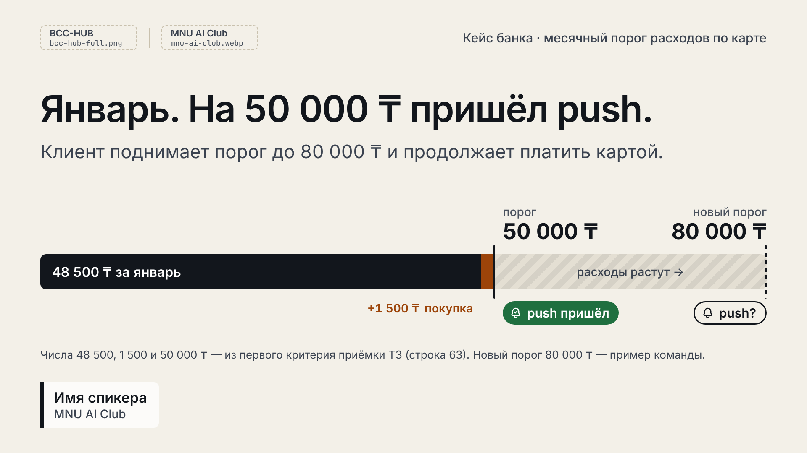
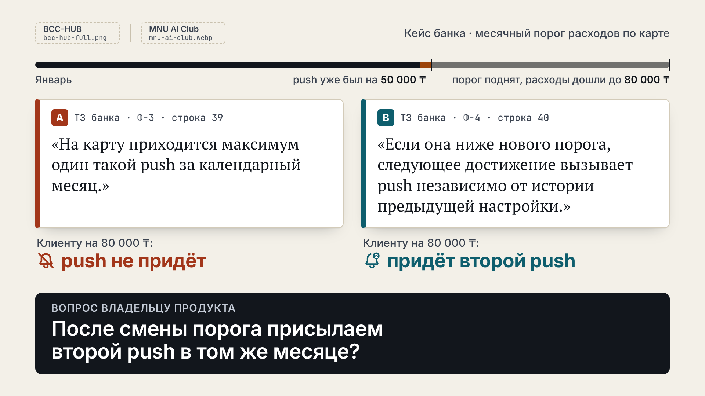

# Первый экран: от финансовой ситуации к вопросу владельцу

**Статус: два статичных ключевых кадра на выбор. Ролика нет.** Утверждённого кадра, с которого
можно было бы продолжить, ни в репозитории, ни в артефактах нет. Поэтому, как условлено для
незавершённого утверждения, здесь только начало и конец перехода. Ролик на 6–8 с собирается после
выбора; план — в конце файла.

| Кадр A — финансовая ситуация (начало) | Кадр B — две формулировки ТЗ и вопрос (конец) |
| :---: | :---: |
|  |  |

## Что видит зал

1. **Кадр A.** Январь. Клиент тратит 48 500 ₸, покупка на 1 500 ₸ доводит расходы до порога
   50 000 ₸, приходит push. Клиент поднимает порог до 80 000 ₸ и продолжает платить. На отметке
   80 000 ₸ стоит «push?».
2. **Кадр B.** Шкала сжимается в строку наверху. Под ней две дословные формулировки ТЗ, и под
   каждой — что получит клиент на 80 000 ₸:
   * **A, Ф-3:** push **не придёт**: лимит «один push за календарный месяц» уже исчерпан;
   * **B, Ф-4:** придёт **второй push**: порог сменился, история прежней настройки не учитывается.
3. Внизу один вопрос владельцу продукта: **«После смены порога присылаем второй push в том же месяце?»**
   «Да» означает, что править нужно Ф-3, «нет» — что Ф-4. Ответ на этот вопрос — решение банка, а не
   разработчика.

## Какие формулировки взяты из ТЗ банка

Источник: [`BCC-HUB/ai-requirements-validator-task` @ `928c1aa`, `docs/requirements.md`](https://github.com/BCC-HUB/ai-requirements-validator-task/blob/928c1aa364265426105b69ba7a3444eac11b22db/docs/requirements.md),
SHA-256 `e7dae55e…d74381`, байт в байт совпадает с `release/input/requirements.md` в `bcc/integration`.

| На экране | Формулировка | Строка ТЗ | Как использована |
| :--- | :--- | :---: | :--- |
| Кадр B, карточка A | «На карту приходится максимум один такой push за календарный месяц.» | 39 (Ф-3) | **дословно**, второе предложение Ф-3 |
| Кадр B, карточка B | «Если она ниже нового порога, следующее достижение вызывает push независимо от истории предыдущей настройки.» | 40 (Ф-4) | **дословно**, второе предложение Ф-4 |
| Кадр A, шкала и сноска | 48 500 ₸, 1 500 ₸, 50 000 ₸, «один push» | 63 (критерий приёмки №1) | только числа сценария, в тексте команды; источник назван в сноске |
| Оба кадра, строка вверху справа | «месячный порог расходов по карте» | 14 (наименование задачи) | название темы, не цитата |

Всё остальное написали мы: заголовок, порог 80 000 ₸ (в сноске он помечен как пример команды),
исходы для клиента, вопрос владельцу, реплика спикера. `python3 tools/verify-quotes.py` сверяет обе
цитаты и числа сценария с исходником и проверяет SHA-256.

## Реплика спикера (≈ 13 с)

> *(кадр A)* Январь. На пятидесяти тысячах тенге клиент получил push и поднял порог до восьмидесяти.
> *(переход)* Придёт ли второй push? Ф-3 отвечает «нет», Ф-4 — «да».
> *(кадр B)* Выбирать за банк разработчик не должен. Это вопрос владельцу продукта.

Реплика не опирается ни на какие цифры качества и ни на итог живого прогона. Цифры качества и
результат живого прогона можно добавить в реплику только из подтверждённых данных: из
`release/reports/live/` с `verify OK` или из протокола оценщика `bcc/eval-independent`. Сейчас ни того,
ни другого нет. Офлайн-отчёт без модели (`release/reports/offline`) противоречие Ф-3 и Ф-4 замечанием
не выводит, поэтому говорить «агент это нашёл» пока нельзя.

## Слова документа отдельно от подписи спикера

| Голос | Шрифт | Где и как выглядит | Разметка |
| :--- | :--- | :--- | :--- |
| Документ (ТЗ банка) | PT Serif, в «ёлочках» | только внутри белых карточек кадра B | `data-voice="doc"` |
| Адрес в документе | JetBrains Mono | шапка карточки: «ТЗ банка · Ф-3 · строка 39» | `data-voice="ref"` |
| Команда | Inter, прямо на фоне | заголовок, шкала, исходы для клиента, вопрос | `data-voice="team"` |
| Подпись спикера | Inter на светлой плашке с чёрной чертой | только кадр A, левый нижний угол; в кадре B цитат рядом нет | `data-voice="speaker"` |

## Читаемость: проектор 16:9 и копия 720p

Замеры выдаёт `tools/render.mjs`, полный список лежит в `exports/checks.json`. Для визуальной проверки:
`exports/check/sheet-{a,b}.png`, где рядом показаны имитация проектора и копия 720p.

| | Кадр A | Кадр B |
| :--- | :---: | :---: |
| Самый мелкий текст, 1080p / 720p | 26 / 17,3 px (сноска) | 26 / 17,3 px (адрес цитаты) |
| Цитаты, 1080p / 720p | — | 44 / 29 px |
| Вопрос, 1080p / 720p | — | 56 / 37 px |
| Худший контраст на экране | 5,7 : 1 | 6,0 : 1 |
| Худший контраст в имитации проектора¹ | 4,2 : 1 (покупка +1 500 ₸, 28 px, полужирный) | 4,3 : 1 («push не придёт», 52 px) |
| Текст в безопасных полях 5 %, без наложений и переполнений | да | да |

¹ Имитация проектора: чёрный поднят до 6 % яркости, белый опущен до 92 %. Порог 3 : 1 для крупного
текста (не меньше 24 px полужирным или 32 px) и 4,5 : 1 для остального. Все элементы его проходят.

Время чтения кадра B: в двух цитатах 24 слова, в вопросе ещё 10, всего 34 слова. При 3 словах в
секунду на это нужно около 11 с.

## Логотипы

В кадрах **пока стоят места под знаки** с именами файлов. Официальные файлы с `bcchubagents.mnu.kz`
не скачались: сеть этой облачной среды не пускает на этот хост. Знаки мы не перерисовывали. Когда
файлы будут:

```bash
tools/fetch-logos.sh && node tools/render.mjs
```

Сборка возьмёт `assets/logos/bcc-hub-full.png` и `assets/logos/mnu-ai-club.webp` сама, разметку
трогать не нужно. Высота знаков задана токеном `--logo-h`, порядок — разметкой `.brand` в `index.html`.

## Как править и пересобрать

* `index.html` — тексты обоих кадров. Открывается с диска без сети: `index.html?frame=a`,
  `?frame=b`, `?frame=all` (оба рядом). Стрелки ← → переключают кадры.
* `frame.css` — цвета, кегли, поля, высота логотипов. Всё вынесено в токены в начале файла. Если в
  дизайнерском чате уже приняты другие шрифты, цвета или поля, их правят здесь, без правки разметки.
* `assets/fonts/` — урезанные Inter, PT Serif и JetBrains Mono (кириллица, ₸, стрелки); лицензия
  OFL лежит рядом. Шрифты в системе не нужны.
* Числа на шкале — атрибуты `--from`, `--to`, `--at`, `--max` в разметке. Положение считается само.
* «Имя спикера» в кадре A — заполнить перед экспортом.

```bash
node tools/render.mjs
```

```bash
python3 tools/verify-quotes.py
```

Для `render.mjs` нужны Node 18+, `playwright` с Chromium, `ffmpeg` и ImageMagick. `verify-quotes.py`
работает на чистом Python 3. Без сети ему можно передать локальный файл ТЗ.

## Если кадры утвердят: переход

* Шкала из кадра A не исчезает, а сжимается в строку наверху кадра B (общий элемент). Знак «push?»
  на 80 000 ₸ превращается в блок вопроса.
* По тексту: на 34 слова финального кадра нужно около 11 с. Движение должно закончиться к 3-й секунде
  (сначала карточка A, затем B, затем вопрос), после этого кадр B держится до конца ролика и
  остаётся на экране, пока спикер договаривает. Если ролик должен влезть ровно в 8 с, Ф-4 можно
  сократить до «…следующее достижение вызывает push независимо от истории предыдущей настройки.».
  Это минус 5 слов, но нужно отдельное согласие: в цитате пропадёт условие.

## Файлы

```text
index.html, frame.css, frame.js   редактируемый исходник двух кадров
assets/fonts/                     шрифты и лицензии OFL
assets/logos/                     сюда кладутся официальные знаки (сейчас только .gitkeep)
tools/render.mjs                  экспорт PNG 1080p и 720p, имитация проектора, замеры
tools/verify-quotes.py            сверка слов документа с ТЗ @ 928c1aa
tools/fetch-logos.sh              загрузка официальных знаков
exports/keyframe-{a,b}-1080p.png  мастер для проектора 16:9
exports/keyframe-{a,b}-720p.png   уменьшенная копия
exports/check/                    имитация проектора и сравнение с 720p
exports/checks.json               замеры читаемости
```
